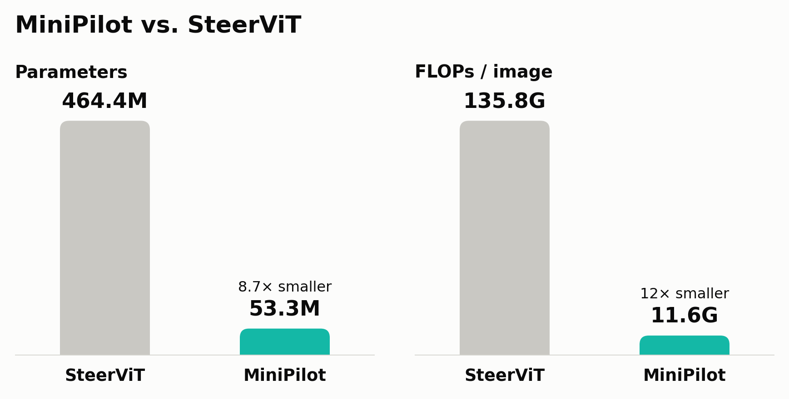

<p align="center">
  
</p>

---
<p align="center">
  
</p>


## Model

| Name | Vision Encoder | Text Encoder | Grid | `d_vis` | Params (trainable) |
|------|---------------|-------------|---------|---------|----------------------|
| **MiniPilot** | DINOv3 ViT-S/16 (`dinov3_vits`) | MiniLM-L6 (`minilm-l6`) | 14×14 (196) | 384 | ~4M |
| **NanoPilot** | ViT-Tiny/16 (`vit_tiny`) | MiniLM-L6 (`minilm-l6`) | 14×14 (196) | 192 | ~2M |
| **PicoPilot** | EfficientFormerV2-S0 (`efficientformerv2_s0`) | MiniLM-L6 (`minilm-l6`) | 7×7 (49) | 176 | ~1.1M |
| **FemtoPilot** | MobileViT-XXS (`mobilevit_xxs`) | MiniLM-L6 (`minilm-l6`) | 8×8 (64) | 320 | ~2M |

```bash
# MiniPilot
python train.py --config configs/config.yaml --vision-encoder dinov3_vits --text-encoder minilm-l6 --out ./ckpts_minipilot

# NanoPilot
python train.py --config configs/config.yaml --vision-encoder vit_tiny --text-encoder minilm-l6 --out ./ckpts_nanopilot

# PicoPilot
python train.py --config configs/config.yaml --vision-encoder efficientformerv2_s0 --text-encoder minilm-l6 --out ./ckpts_picopilot

# FemtoPilot
python train.py --config configs/config.yaml --vision-encoder mobilevit_xxs --text-encoder minilm-l6 --out ./ckpts_femtopilot
```

## Result

Results of the CORE benchmark proxy evaluation (`test.py`). Values are in %; bold marks the best value in each column.
Training setup shared by MiniPilot / NanoPilot: `--teacher bbox --dataset all --epochs 30`. SteerViT is the original pretrained model (`steervit_dinov2_base.pth`, 336px input, 24×24 grid) evaluated with the same script.

- **PA** (Pointing Accuracy): fraction of samples where the center of the heatmap's argmax patch falls inside the GT bbox (↑)
- **AHP** (Avg Heatmap Precision): fraction of heatmap mass inside the GT bbox (↑)
- **PA_wrong**: PA when the text prompts are shuffled. The larger the gap to PA, the more the model relies on the text to localize

### PA (%)

| Model | RefCOCO val | RefCOCO testA | RefCOCO testB | RefCOCO+ val | RefCOCO+ testA | RefCOCO+ testB | RefCOCOg val | VG val | GQA val |
|---|---:|---:|---:|---:|---:|---:|---:|---:|---:|
| SteerViT (original) | **87.9** | **89.6** | **85.3** | **80.4** | **86.3** | **74.3** | **84.2** | 71.1 | 53.0 |
| **MiniPilot** | 84.5 | 88.2 | 82.0 | 72.0 | 78.3 | 62.6 | 79.2 | **73.8** | **59.4** |
| NanoPilot | 79.0 | 79.4 | 77.6 | 64.5 | 69.4 | 58.5 | 71.4 | 64.9 | 51.7 |

### AHP (%)

| Model | RefCOCO val | RefCOCO testA | RefCOCO testB | RefCOCO+ val | RefCOCO+ testA | RefCOCO+ testB | RefCOCOg val | VG val | GQA val |
|---|---:|---:|---:|---:|---:|---:|---:|---:|---:|
| SteerViT (original) | **80.1** | **84.2** | **75.4** | **74.9** | **82.2** | **66.5** | **78.0** | 61.6 | 47.9 |
| **MiniPilot** | 76.0 | 79.1 | 73.1 | 64.5 | 71.1 | 56.0 | 69.7 | **63.7** | **53.5** |
| NanoPilot | 67.3 | 68.2 | 66.4 | 54.3 | 57.6 | 50.0 | 59.5 | 53.6 | 44.8 |

### PA_wrong (%)

| Model | RefCOCO val | RefCOCO testA | RefCOCO testB | RefCOCO+ val | RefCOCO+ testA | RefCOCO+ testB | RefCOCOg val | VG val | GQA val |
|---|---:|---:|---:|---:|---:|---:|---:|---:|---:|
| SteerViT (original) | 26.0 | 28.7 | 29.2 | 28.1 | 28.8 | 30.5 | 32.6 | 23.5 | 18.2 |
| **MiniPilot** | 20.9 | 25.0 | 22.3 | 23.7 | 26.1 | 26.6 | 30.5 | 23.3 | 17.5 |
| NanoPilot | 22.5 | 24.9 | 22.8 | 24.6 | 27.4 | 26.1 | 30.3 | 23.3 | 17.3 |

- SteerViT is better on RefCOCO / RefCOCO+ / RefCOCOg. The PA gap to MiniPilot is small on RefCOCO (+1.4–3.4pt), +5.0pt on RefCOCOg and largest on RefCOCO+ (+8–12pt).
- MiniPilot beats SteerViT on VG (+2.7pt PA) and GQA (+6.4pt PA). MiniPilot was trained with `--dataset all` (including VG and GQA), which likely helps on these in-distribution sets.
- MiniPilot (DINOv3) is the best of the small models on every dataset. Compared with NanoPilot (ViT-Tiny), its PA is +4–9pt higher on RefCOCO, +8.9pt on VG and +7.7pt on GQA.
- NanoPilot's RefCOCO+ / RefCOCOg / GQA numbers are taken from the text logs (`logs/test_output_minilm_l6_*.txt`).

### Model size and compute (vs. SteerViT)

| Model | Vision / Text | Total params | Trainable | FLOPs (B=1) | RefCOCO val PA |
|---|---|---:|---:|---:|---:|
| SteerViT (original) | DINOv2 ViT-B/14 / RoBERTa-large | 464.4M | 23.1M | 135.76G (336px) | 87.9 |
| **MiniPilot** | DINOv3 ViT-S/16 / MiniLM-L6 | 53.3M (11.5%) | 9.03M | 11.55G (8.5%) | 84.5 |
| NanoPilot | ViT-Tiny/16 / MiniLM-L6 | 30.5M (6.6%) | 2.30M | 3.38G (2.5%) | 79.0 |

- (%) is relative to SteerViT. Trainable = connector + GatedCrossAttn + lin_seg_head.
- Values are taken from the parameter / FLOPs tables printed by `test.py`.
- 76% of SteerViT's parameters are in the text encoder (RoBERTa-large, 355M). For MiniPilot / NanoPilot the text side (MiniLM-L6, 22.7M) still accounts for 40–70% of the total.
- SteerViT was evaluated with `test.py` (without `--no-steervit`); logs are in `logs/test_output_steervit_*.txt`. MiniPilot reaches 96% of SteerViT's RefCOCO val PA with 11.5% of the parameters and 8.5% of the FLOPs.

---

## Architecture

```
Text input
  └─ Text encoder (frozen, selected with --text-encoder)
       └─ connector: Linear(d_text → d_vis)  ★trained
            └─ GatedCrossAttn × n_blocks  ★trained
                 └─ Vision backbone (pretrained, frozen, selected with --vision-encoder)
                      └─ lin_seg_head: Linear(d_vis → 1)  ★trained
                           └─ patch logits (grid×grid patches)

Loss: SoftCE(student_logits, teacher_soft)
```

| Component | Params | Trained |
|--------------|------------|------|
| Vision backbone | see table below | ✗ frozen (ImageNet pretrained) |
| Text encoder | see table below | ✗ frozen |
| connector (d_text→d_vis) | d_text × d_vis | ✓ |
| GatedCrossAttn × n | ~1–3M | ✓ |
| lin_seg_head | d_vis + 1 | ✓ |

---

## Vision encoder (`--vision-encoder`)

The backbone can be switched with `--vision-encoder`.

| Key | Model | Input resolution | Grid | `d_vis` | GCA insertion points |
|------|--------|-----------|---------|---------|-------------|
| `vit_tiny` (default) | `vit_tiny_patch16_224` | 224×224 | 14×14 (196) | 192 | after every Transformer block (×12) |
| `dinov3_vits` | `vit_small_patch16_dinov3.lvd1689m` | 224×224 | 14×14 (196) | 384 | after every Transformer block (×12) |
| `efficientformerv2_s0` | `efficientformerv2_s0.snap_dist_in1k` | 224×224 | 7×7 (49) | 176 | after every block (×14: s0×2, s1×2, s2×6, s3×4) |
| `fastvit_t8` | `fastvit_t8.apple_dist_in1k` | 256×256 | 8×8 (64) | 768 | after every stage (×4) |
| `mobilevit_xxs` | `mobilevit_xxs` | 256×256 | 8×8 (64) | 320 | after every stage (×5) |

- `vit_tiny` / `dinov3_vits`: patch-token ViTs with a CLS token (num_prefix=1)
- `efficientformerv2_s0`: hierarchical ViT (stem + 4 stages). Early stages are MLP-only, later stages use Attention2d. No CLS token (num_prefix=0)
- `fastvit_t8` / `mobilevit_xxs`: CNN-like stem + stages + final_conv structure. No CLS token (num_prefix=0)

Changing the vision encoder automatically changes the `connector` size (`d_text → d_vis`) and the number of GCA blocks.  
The setting is saved in the checkpoint and restored automatically when `test.py` loads it.

```bash
python train.py --config configs/config.yaml --vision-encoder efficientformerv2_s0 --out ./ckpts_picopilot
python train.py --config configs/config.yaml --vision-encoder fastvit_t8 --out ./ckpts_fastvit
python train.py --config configs/config.yaml --vision-encoder mobilevit_xxs --out ./ckpts_mobilevit
```

---

## Text encoder (`--text-encoder`)

| Key | Model | `d_text` | Params |
|------|--------|----------|------------|
| `distilroberta` (default) | `distilbert/distilroberta-base` | 768 | ~82M |
| `tinybert-l6` | `huawei-noah/TinyBERT_General_6L_768D` | 768 | ~67M |
| `tinybert-l4` | `huawei-noah/TinyBERT_General_4L_312D` | 312 | ~14M |
| `minilm-l6` | `sentence-transformers/all-MiniLM-L6-v2` | 384 | ~23M |

Changing the text encoder automatically changes the `connector` size (`d_text → d_vis`) as well.  
The text encoder is saved in the checkpoint and restored automatically when `test.py` loads it.

---

## Teacher types (`--teacher`)

The `--teacher` option selects the source of the teacher soft target.

### `steervit` (default)

Uses the heatmap of pretrained SteerViT as the teacher.

```
full_img (224px)
  → bicubic resize → 336px
  → SteerViT (DINOv2-base, frozen)
  → patch logits (24×24 = 576)
  → softmax → bilinear resize → 14×14 → teacher_soft
```

- Pros: high-quality soft targets produced by a model that has already learned text–image correspondence
- Cons: loading SteerViT requires GPU memory (~1.5GB)

### `bbox`

Uses the normalized patch-overlap area of the GT bbox as the teacher distribution.

```
bbox [x1, y1, x2, y2] (relative coordinates)
  → compute intersection area with each patch (14×14)
  → normalize by area → teacher_soft
```

- Pros: no SteerViT needed, fast, faithful to the annotations
- Cons: treats the bbox interior uniformly, so the meaning of the text is not reflected

### `both`

Uses the average of the SteerViT heatmap and the bbox mask as the teacher.

```
teacher_soft = 0.5 × steervit_soft + 0.5 × bbox_soft
```

- Pros: supervises with both text semantics and GT location

---

## Environment

```bash
conda activate steerdet
```

Required packages: `torch`, `timm >= 1.0`, `transformers`, `torchvision`, `pycocotools`, `tqdm`, `matplotlib`, `pyyaml`

---

## Datasets

| Dataset | Path | Notes |
|-------------|------|------|
| RefCOCO | `/data2/kato/dataset/coco/refcoco/` | `refs(unc).p` + `instances.json` |
| COCO 2017 | `/data2/kato/dataset/coco/` | `train2017/`, `val2017/`, `annotations/` |
| Visual Genome | `/data2/kato/dataset/vg/` | `region_descriptions.json` |
| GQA | `/data2/kato/dataset/GQA/` | `*_sceneGraphs.json` |
| BDD100k | `/data2/kato/dataset/BDD100k/` | WIP |
| LVIS | `/data2/kato/dataset/lvis/` | WIP |
| Object365 | WIP | WIP |

Paths can be changed in the `paths` section of `config.yaml`.

---

## Config file (`config.yaml`)

All parameters and paths can be managed in `config.yaml`.  
**Priority: CLI arguments > config.yaml > argparse defaults**

```yaml
paths:
  coco_root:     "/data2/kato/dataset/coco"
  vg_root:       "/data2/kato/dataset/vg"
  gqa_root:      "/data2/kato/dataset/GQA"
  steervit_ckpt: "/path/to/steervit_dinov2_base.pth"

train:
  text_encoder: "distilroberta"   # distilroberta | tinybert-l6 | tinybert-l4 | minilm-l6
  teacher:      "steervit"        # steervit | bbox | both
  dataset:      "refcoco"
  epochs:       50
  batch_size:   64
  lr:           3.0e-4
  out:          "./ckpts"
  ...

test:
  ckpt:       null   # default for test.py --ckpt
  dataset:    "refcoco"
  batch_size: 64
  ...
```

```bash
# Run with config.yaml as the base (CLI arguments override)
python train.py --config configs/config.yaml

# Override only part of the config
python train.py --config configs/config.yaml --epochs 30 --batch-size 128 --text-encoder tinybert-l4
```

---

## Training

```bash
# Run with the default settings in config.yaml
python train.py --config configs/config.yaml

# Train with a different text encoder
python train.py --config configs/config.yaml --text-encoder tinybert-l4 --out ./ckpts_tinybert_l4
python train.py --config configs/config.yaml --text-encoder tinybert-l6 --out ./ckpts_tinybert_l6
python train.py --config configs/config.yaml --text-encoder minilm-l6   --out ./ckpts_minilm_l6

# bbox mask teacher (no SteerViT needed, fast)
python train.py --config configs/config.yaml --teacher bbox

# Train with a different vision encoder
python train.py --config configs/config.yaml --vision-encoder dinov3_vits         --out ./ckpts_dinov3_vits
python train.py --config configs/config.yaml --vision-encoder efficientformerv2_s0 --out ./ckpts_picopilot
python train.py --config configs/config.yaml --vision-encoder fastvit_t8           --out ./ckpts_fastvit
python train.py --config configs/config.yaml --vision-encoder mobilevit_xxs        --out ./ckpts_mobilevit

# Train with a teacher cache (SteerViT is not loaded)
python precompute_teacher.py --dataset refcoco --out ./teacher_cache/refcoco       # precompute (first time only)
python train.py --config configs/config.yaml --teacher-cache ./teacher_cache/refcoco       # heatmap distillation only
python train.py --config configs/config.yaml --teacher-cache ./teacher_cache/refcoco --attn-distil  # with attn distillation

# Train on all datasets
python train.py --config configs/config.yaml --dataset all --batch-size 512 --teacher bbox
```

Default settings:

| Setting | Value |
|------|---|
| backbone | vit_tiny_patch16_224 (ImageNet pretrained) |
| text encoder | `distilroberta` (frozen) |
| teacher | `steervit` |
| full image size (student) | 224×224 |
| full image size (teacher) | 336×336 (bicubic resize internally) |
| epochs | 50 |
| batch size | 64 |
| lr | 3e-4 (CosineAnnealing → 3e-6) |
| optimizer | AdamW (weight_decay=1e-2) |

---

## Attention Distillation (`--attn-distil`)

With `--teacher steervit` or `--teacher both`, in addition to the output heatmap, the **Self-Attention (SA)** and **Cross-Attention (CA)** distributions of each Transformer block can also be distilled from the teacher.

### What is distilled

| Type | Source | Aggregation |
|------|--------|----------|
| **SA** | ViT self-attention in each block | CLS→patch attention averaged over heads → (B, N_patches) |
| **CA** | GatedCrossAttn in each block | patch→text attention averaged over heads and text tokens → (B, N_patches) |

The spatial sizes of the teacher (24×24) and the student (each model's grid: vit_tiny=14×14, efficientformerv2_s0=7×7, etc.) are aligned with bilinear interpolation and distilled with KL divergence.

### Loss composition

```
total_loss = heatmap_loss
           + attn_weight × (sa_weight × SA_loss + ca_weight × CA_loss)
```

### Examples

```bash
# Default weights (attn_weight=1.0, sa=1.0, ca=1.0)
python train.py --config configs/config.yaml --teacher steervit --attn-distil

# heatmap : attn = 1 : 0.5, SA only
python train.py --config configs/config.yaml --teacher steervit --attn-distil \
    --attn-weight 0.5 --ca-weight 0.0

# Also works in both mode
python train.py --config configs/config.yaml --teacher both --attn-distil \
    --attn-weight 1.0 --sa-weight 1.0 --ca-weight 0.5
```

> **Note**: attn-distil is ignored with `--teacher bbox` (SteerViT is not used).

### Log output

When `--attn-distil` is enabled, a breakdown is appended to each epoch's log line:

```
[  1/ 50] train=16.01  val=15.83  lr=3.00e-04  12.3s  hmap=5.46  sa=5.28  ca=5.28
```

`last_heatmap_loss` / `last_sa_loss` / `last_ca_loss` are also recorded in `history.json`.

### Impact on speed and memory

Compared with plain `--teacher steervit`, enabling attn-distil adds the following overhead:

| Item | Impact |
|------|------|
| Number of teacher forwards | unchanged (heatmap and attention are obtained in a single forward) |
| Teacher forward speed | slower, because Flash Attention is disabled in all blocks |
| Student forward speed | slower, because attention maps are collected from all blocks |
| VRAM | increases, because attention maps of all blocks are kept |

→ To speed up training, use the **teacher cache** (`precompute_teacher.py`).

---

## Teacher cache (`precompute_teacher.py`)

With `--teacher steervit` or `--attn-distil`, SteerViT runs on every batch, which slows training down.  
If you **precompute and save SteerViT's outputs** with `precompute_teacher.py`, training only reads from the cache without loading SteerViT.

### Saved files

| File | Content | Shape | dtype |
|---------|------|------|-------|
| `soft.dat` | softmax heatmap | (N, 576) | float16 |
| `sa.dat` | compressed SA attention distribution | (N, n_blocks, 576) | float16 |
| `ca.dat` | compressed CA attention distribution | (N, n_blocks, 576) | float16 |
| `meta.json` | metadata | — | JSON |

With `--no-attn`, `sa.dat` / `ca.dat` are skipped (recommended for heatmap-only distillation).

How SA/CA are compressed:
- **SA**: CLS→patch attention averaged over heads → normalized → (576,) per block
- **CA**: patch→text attention averaged over heads and text → normalized → (576,) per block

### Step 1: Generate the cache

**Local** (`precompute_teacher.py`):

```bash
# Save heatmap + SA/CA (when combined with --attn-distil)
python precompute_teacher.py \
    --dataset refcoco \
    --out ./teacher_cache/refcoco \
    --split train

# Heatmap only (faster, when not using attn distillation)
python precompute_teacher.py \
    --dataset refcoco \
    --out ./teacher_cache/refcoco_noattn \
    --split train \
    --no-attn

# Same for the val set
python precompute_teacher.py --dataset refcoco --out ./teacher_cache/refcoco_val --split val
```

Resulting directory structure:

```
teacher_cache/
  refcoco/    meta.json  soft.dat  sa.dat  ca.dat
  refcoco+/   meta.json  soft.dat  ...
  refcocog/   ...
  vg/         ...
  gqa/        ...
```

| Option | Default | Description |
|-----------|-----------|------|
| `--dataset` | (required) | `refcoco` / `refcoco+` / `refcocog` / `vg` / `gqa` / `coco` |
| `--out` | (required) | output directory |
| `--split` | `train` | `train` / `val` |
| `--no-attn` | off | do not save SA/CA (soft heatmap only) |
| `--steervit-ckpt` | config | SteerViT checkpoint path |
| `--batch-size` | `32` | batch size |
| `--num-workers` | `4` | number of DataLoader workers |

### Step 2: Train with the cache

**Local** (`train.py`):

```bash
# Heatmap distillation only (SteerViT is not loaded)
python train.py --config configs/config.yaml \
    --dataset refcoco \
    --teacher-cache ./teacher_cache/refcoco_noattn

# Attn distillation from the cache too (requires a cache generated with SA/CA)
python train.py --config configs/config.yaml \
    --dataset refcoco \
    --teacher-cache ./teacher_cache/refcoco \
    --attn-distil
```

When `--teacher-cache` is given:
- SteerViT is **not loaded** (faster startup, less VRAM)
- `fix_text=True` makes text selection deterministic so it matches the cache
- sample indices are attached to each batch so the cache is looked up correctly
- with `--dataset all`, `MultiTeacherCache` automatically combines the subdirectories

Cache directory structure for `--dataset all`:

```
teacher_cache/          ← root directory passed to --teacher-cache
  refcoco/   meta.json  soft.dat  [sa.dat  ca.dat]
  refcoco+/  ...
  refcocog/  ...
  vg/        ...
  gqa/       ...
```

> **Note 1**: Build the cache for the **train split only**.  
> The val set does not run SteerViT in the first place, so it is already fast (no cache needed).  
> **Note 2**: Do not pass `--max-train` when using `--dataset all` + `--teacher-cache`.  
> `max_train` changes the size of each sub-dataset, so the indices no longer match the cache.

---

## Options

### train.py

| Option | Default | Description |
|-----------|-----------|------|
| `--config` | — | YAML config file (CLI arguments override) |
| `--text-encoder` | `distilroberta` | `distilroberta` / `tinybert-l6` / `tinybert-l4` / `minilm-l6` |
| `--vision-encoder` | `vit_tiny` | `vit_tiny` / `dinov3_vits` / `efficientformerv2_s0` / `fastvit_t8` / `mobilevit_xxs` |
| `--teacher` | `steervit` | teacher type: `steervit` / `bbox` / `both` |
| `--no-pretrained-backbone` | — | randomly initialize the vision backbone as well |
| `--dataset` | `refcoco` | `refcoco` / `refcoco+` / `refcocog` / `vg` / `gqa` / `coco` / `all` |
| `--epochs` | `50` | number of training epochs |
| `--batch-size` | `64` | batch size |
| `--val-batch-size` | `16` | batch size of the val loader |
| `--lr` | `3e-4` | initial learning rate |
| `--weight-decay` | `1e-2` | AdamW weight decay |
| `--amp` | on | mixed precision (bf16 on GPUs that support it, otherwise FP16 + GradScaler) |
| `--resume` | — | resume from a checkpoint |
| `--out` | `./ckpts` | output directory |
| `--vis-every` | `5` | visualize heatmaps every N epochs (0 to disable) |
| `--vis-n` | `4` | number of probes collected automatically from the val set |
| `--vis-samples` | — | custom probe JSON |
| `--attn-distil` | off | enable SA / CA attention map distillation |
| `--attn-weight` | `1.0` | overall weight of the attention distillation loss |
| `--sa-weight` | `1.0` | weight of the SA loss |
| `--ca-weight` | `1.0` | weight of the CA loss |
| `--teacher-cache` | — | directory of a precomputed teacher cache (generated by `precompute_teacher.py`) |
| `--coco-root` | (config) | root path of the COCO dataset |
| `--vg-root` | (config) | root path of Visual Genome |
| `--gqa-root` | (config) | root path of GQA |
| `--steervit-ckpt` | (config) | SteerViT checkpoint path |

### test.py

| Option | Default | Description |
|-----------|-----------|------|
| `--config` | — | YAML config file |
| `--ckpt` | (required) | TinySteerViT checkpoint (.pth) |
| `--dataset` | `refcoco` | `refcoco` / `refcoco+` / `refcocog` / `vg` / `gqa` |
| `--split` | all splits | `val` / `testA` / `testB` (`val` only for refcocog, vg and gqa) |
| `--max-samples` | all | maximum number of samples per split |
| `--batch-size` | `64` | batch size |
| `--num-workers` | `4` | number of DataLoader workers |
| `--no-steervit` | — | skip the comparison with the SteerViT teacher |
| `--no-wrong-prompt` | — | skip the wrong-prompt control experiment |
| `--vision-encoder` | (ckpt) | override the value saved in the checkpoint |
| `--text-encoder` | (ckpt) | override the value saved in the checkpoint |
| `--log` | auto-generated | path of the JSON file to save results to |
| `--coco-root` | (config) | root path of the COCO dataset |
| `--vg-root` | (config) | root path of Visual Genome |
| `--gqa-root` | (config) | root path of GQA |
| `--steervit-ckpt` | (config) | SteerViT checkpoint path |

---

## Output

```
ckpts/
  train.log          # timestamped log
  history.json       # train/val loss per epoch
  best_model.pth     # checkpoint with the best val_loss
  vis/
    epoch_000.png    # before training (initial state)
    epoch_005.png
    ...
```

Structure of `best_model.pth`:

```python
{
    "epoch":    int,
    "sv_state": dict,   # state_dict of connector + gated_cross_attn + lin_seg_head
    "val_loss": float,
    "args":     dict,   # all training arguments, including text_encoder
}
```

Resume:

```bash
python train.py --config configs/config.yaml --resume ./ckpts/best_model.pth
```

---

## Visualization

The column layout of each epoch's PNG depends on `--teacher`:

| `--teacher` | Col 1 | Col 2 | Col 3 | Col 4 |
|------------|-----|-----|-----|-----|
| `steervit` | full image + bbox | teacher (SteerViT) | student | — |
| `bbox`     | full image + bbox | teacher (bbox mask) | student | — |
| `both`     | full image + bbox | teacher (SteerViT) | teacher (bbox mask) | student |

- **full image + bbox**: input image with the text and the GT bbox drawn as a yellow box
- **teacher (SteerViT)**: heatmap produced by SteerViT from a 336px input (24×24 grid)
- **teacher (bbox mask)**: normalized patch-overlap distribution of the GT bbox (14×14 grid)
- **student**: output heatmap of TinySteerViT (14×14 grid)

To use custom probes:

```json
[
  {"img_path": "/path/to/image.jpg", "text": "person on the left", "bbox": [0.1, 0.2, 0.6, 0.9]},
  {"img_path": "/path/to/image2.jpg", "text": "red car"}
]
```

`bbox` is `[x1, y1, x2, y2]` in relative coordinates. If omitted, `[0, 0, 1, 1]` (the whole image) is used.

```bash
python train.py --config configs/config.yaml --vis-samples probes.json --vis-every 1
```

---

## Evaluation (CORE Benchmark)

As a proxy for the CORE (COnditional REtrieval) benchmark from the paper (arXiv:2604.02327),
Pointing Accuracy is measured on RefCOCO / RefCOCO+ / RefCOCOg / Visual Genome / GQA.

The text encoder is restored automatically from the checkpoint.

### Metrics

| Metric | Description |
|------|------|
| **PA** (Pointing Accuracy) | hit if the center of the argmax heatmap patch is inside the GT bbox |
| **AHP** (Avg Heatmap Precision) | fraction of heatmap mass inside the GT bbox |
| **PA_wrong** | PA when the text prompts are shuffled |
| **ΔPA** | PA − PA_wrong (larger = more text-dependent) |

### Examples

```bash
# Evaluate using the paths in config.yaml
python test.py --config configs/config.yaml --ckpt ./ckpts_picopilot_all/best_model.pth

# Specify a split
python test.py --config configs/config.yaml --ckpt ./ckpts_picopilot_all/best_model.pth --split val

# Switch datasets
python test.py --config configs/config.yaml --ckpt ./ckpts_picopilot_all/best_model.pth --dataset refcoco+
python test.py --config configs/config.yaml --ckpt ./ckpts_picopilot_all/best_model.pth --dataset vg
python test.py --config configs/config.yaml --ckpt ./ckpts_picopilot_all/best_model.pth --dataset gqa

# Limit the number of samples for a quick check
python test.py --config configs/config.yaml --ckpt ./ckpts_picopilot_all/best_model.pth --max-samples 500

# Skip the comparison with SteerViT (TinySteerViT only)
python test.py --config configs/config.yaml --ckpt ./ckpts_picopilot_all/best_model.pth --no-steervit
```

---

## File structure

```
MiniPilot/
  configs/                # default settings for all parameters and paths (config.yaml / config_tiny.yaml / config_distill.yaml)
  model.py                # GatedCrossAttn / TinyViTBackbone / EfficientFormerV2Backbone
                          # FastViTBackbone / MobileViTXXSBackbone / TinySteerViT
                          # TeacherCache / MultiTeacherCache
                          # AttnDistilLoss / HeatmapSoftCELoss
                          # TEXT_ENCODERS / VISION_ENCODERS
  dataset.py              # RefCOCOLocalDataset / COCODetDataset / VGRegionDataset
                          # GQASceneGraphDataset / _IndexedWrapper / build_loaders
  train.py                # training script
  test.py                 # CORE benchmark evaluation script
  requirements.txt        # requirements
  train.sh                # training example (bash train.sh <minipilot|nanopilot|picopilot|femtopilot>)
  test.sh                 # evaluation example (bash test.sh <ckpt_path>)
```
